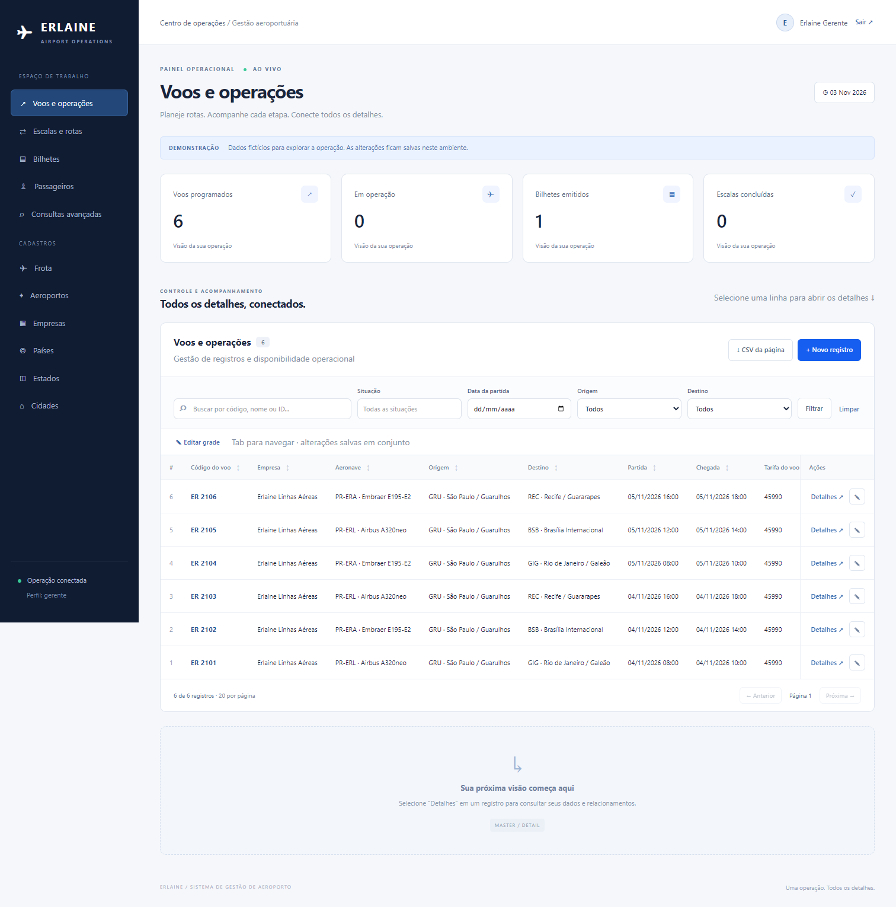

# Erlaine · Sistema de Gestão de Aeroporto

Aplicação baseada no PDF **Documentacao-UML-Sistema-Aeroporto.pdf** (48 páginas): dez entidades, UC01–UC08, estados operacionais e relações mestre/detalhe.

**Stack:** Go, Chi, Go Templates + Templ, Tailwind CSS, SQLite com modernc.org/sqlite, sqlc e HTMX. Um processo, um arquivo de banco, sem servidor de banco separado e sem Node em produção. CSS, JavaScript e templates são incorporados ao executável.



## Rodar em desenvolvimento

Requisito: Go **1.26 ou superior**. O projeto foi validado com Go 1.27.3. Os arquivos gerados estão incluídos: não é necessário instalar Node, Templ ou sqlc para iniciar.

No PowerShell, dentro da pasta extraída:

```powershell
$env:DEMO_MODE = "true"
$env:COOKIE_SECURE = "false"
go run ./cmd/server
```

Acesse **http://localhost:8080**.

| Perfil | E-mail | Senha da demonstração |
|---|---|---|
| Gerente | gerente@demo.local | Demo@2026! |
| Atendente | atendente@demo.local | Demo@2026! |
| Passageiro | passageiro@demo.local | Demo@2026! |

A demonstração cria companhia, geografia, aeroportos, frota, passageiros, seis voos futuros, escalas e um bilhete. A carga é executada apenas quando não existem usuários; reiniciar preserva os dados. Use um banco separado para produção.

O pacote Windows também contém `bin/aeroporto.exe`; execute `Iniciar-Demo.ps1` para iniciar sem SDK Go.

## Usar o sistema

1. O gerente cadastra País → Estado → Cidade → Aeroporto. Adicionar um dependente ativa o registro geográfico pai, conforme os diagramas.
2. Cadastre e ative aeroportos e aeronaves em “Detalhes → Gerenciar estado”.
3. Crie um voo com aeronave da empresa e aeroportos ativos. Uma escala inicial representa o trecho direto; outras escalas podem ser cadastradas e associadas.
4. Em “Detalhes” do voo aparecem escalas, bilhetes e mapa de assentos.
5. O atendente emite bilhetes e pode cadastrar um passageiro no mesmo formulário. Selecione um assento livre no mapa.
6. Check-in exige portão; embarque exige check-in. Cancelamentos exigem motivo e confirmação.
7. O passageiro consulta os voos e somente seus próprios bilhetes, com check-in e cancelamento antes da partida.

**Grade interativa:** “Editar grade” libera as células permitidas pelo estado; Tab navega entre campos. “Salvar alterações” grava todas as linhas modificadas em uma transação. Qualquer erro reverte o conjunto. Há aviso de alterações pendentes, descarte, filtros, ordenação, paginação e CSV da página atual. A criação de registros usa formulário modal. Esta é uma implementação própria do padrão, sem dependência do Oracle APEX.

**Histórico no CRUD principal:** exclusões são lógicas; registros excluídos ficam fora da listagem padrão e podem ser consultados pelo filtro de situação. As transições manuais registram usuário, motivo e horário. Manutenções têm histórico próprio.

## Produção no Render

1. Suba o conteúdo desta pasta para um repositório Git.
2. No Render, crie um **Blueprint** apontando para o repositório; `render.yaml` configura o serviço Docker e disco.
3. Preencha `ADMIN_EMAIL`, `ADMIN_PASSWORD` (mínimo 12 caracteres), `COMPANY_NAME` e `COMPANY_CNPJ` (14 dígitos).
4. O primeiro início cria a empresa ativa e o gerente. Depois cadastre os dados reais pela interface.
5. Mantenha `DATABASE_PATH=/data/aeroporto.db`, `COOKIE_SECURE=true` e `DEMO_MODE=false`.

O blueprint usa **Starter + disco persistente de 1 GB**, sujeitos à cobrança do Render. Sem disco persistente, alterações no SQLite se perdem quando o serviço reinicia ou recebe deploy. O disco deve ficar em uma única instância do serviço; não configure múltiplas réplicas com bancos independentes.

A aplicação está preparada para deploy; não foi publicada em uma conta Render nesta entrega.

Referências oficiais: [discos no Render](https://render.com/docs/disks), [Blueprints](https://render.com/docs/blueprint-spec).

### Por que o backend não vai para a Vercel

A Vercel não mantém um arquivo SQLite local gravável e durável entre execuções de suas funções. Para conservar exatamente esta stack e o banco local, use Render com disco, Docker em VPS ou hospedagem equivalente. Não incluí uma configuração Vercel que perderia os dados. Para usar Vercel seria necessário mudar a arquitetura de persistência, por exemplo para um banco remoto.

Referência: [SQLite na Vercel](https://vercel.com/kb/guide/is-sqlite-supported-in-vercel).

## Docker local

Requisito: Docker com Compose.

```sh
docker compose up --build
```

Acesse http://localhost:8080. O Compose inicia a demonstração, com banco no volume `aeroporto-data`. O Dockerfile compila Go com CGO desabilitado; os assets já estão gerados. O entrypoint prepara as permissões do disco e executa o servidor como usuário `app`.

## Primeiro acesso sem demonstração

PowerShell:

```powershell
$env:DEMO_MODE = "false"
$env:ADMIN_EMAIL = "gerente@empresa.com"
$env:ADMIN_PASSWORD = "uma-senha-forte-de-verdade"
$env:COMPANY_NAME = "Minha companhia aérea"
$env:COMPANY_CNPJ = "12345678000190"
$env:DATABASE_PATH = "data/producao.db"
$env:COOKIE_SECURE = "false" # Somente no desenvolvimento HTTP local
go run ./cmd/server
```

O servidor não carrega arquivos `.env` automaticamente; use as variáveis do terminal ou do provedor. Consulte `.env.example`. Em HTTPS de produção, use `COOKIE_SECURE=true`. Alterar ADMIN_PASSWORD depois do primeiro acesso não redefine uma senha existente.

## Criar contas adicionais

O cadastro de contas ocorre pela CLI para impedir que um visitante escolha seu próprio perfil. Use a mesma variável DATABASE_PATH do servidor.

```powershell
$env:USER_PASSWORD = "outra-senha-forte-de-verdade"
go run ./cmd/server create-user --email atendente@empresa.com --name "Atendente" --role atendente
go run ./cmd/server create-user --email cliente@exemplo.com --name "Cliente" --role passageiro --passenger 1
```

O ID de passageiro é o exibido na grade. Para um segundo gerente da mesma empresa, use `--role gerente --company 1`. Para gerenciar outra companhia, provisione a empresa e vincule uma conta de gerente pela administração do banco; a interface limita cada gerente à sua companhia. Não existe cadastro público nem envio de e-mail.

## Banco e backup

O banco local nasce em `data/aeroporto.db`. O servidor cria o diretório e o esquema no primeiro início. Chaves estrangeiras, modo WAL, espera de bloqueio e índice parcial de assento ativo estão habilitados. Escritas são serializadas e há controle de versão para evitar sobrescrever a edição de outra pessoa.

Para um snapshot consistente, inclusive com o servidor ligado:

```powershell
go run ./cmd/server backup --output backups/aeroporto-2026-10-30.db
```

O comando usa `VACUUM INTO` e recusa sobrescrever um destino existente. Copie o snapshot para armazenamento externo. Não copie apenas o arquivo principal de um banco em uso, pois pode haver dados no WAL.

Para restaurar: pare o serviço, coloque o snapshot em um **novo caminho** e aponte DATABASE_PATH para esse arquivo. Preserve o banco anterior até conferir a restauração. No Render, execute o comando na shell do serviço com saída dentro do disco persistente e copie o backup para fora do provedor.

## Desenvolvimento e geração

Node **20 ou superior** é necessário apenas para recompilar CSS e para o smoke de navegador.

```powershell
./scripts/generate.ps1
```

Linux/macOS: `sh scripts/generate.sh`.

Os scripts executam as versões fixadas de Templ e sqlc, `npm ci`, compilação Tailwind e testes Go. Depois de editar `.templ`, SQL ou CSS, regenere os arquivos antes do deploy. O build Docker não precisa baixar ferramentas de geração.

Verificações:

```sh
go test ./... -count=1
go vet ./...
go build ./cmd/server
npm run build:css
```

Smoke real de navegador: inicie uma demonstração com **banco novo**, porta 8187; em outro terminal, rode:

```powershell
npm ci
$env:BASE_URL = "http://localhost:8187"
$env:BROWSER_PATH = "C:/Program Files/Google/Chrome/Application/chrome.exe"
npm run test:browser
```

O smoke modifica os dados de demonstração e exige uma base nova em cada execução. Em Linux, indique um Chromium instalado em BROWSER_PATH ou instale-o via Playwright. As imagens ficam em `docs/screenshots`.

## Estrutura

```text
cmd/server/                Entrada HTTP, provisionamento de usuários e backup
internal/app/              Regras, autenticação, handlers e metadados das grades
internal/app/templates/    Go Templates dos formulários e fragmentos HTMX
internal/app/static/       CSS compilado, HTMX local e JavaScript da interface
internal/database/         Esquema, queries e código sqlc
internal/ui/               Layout Templ e código gerado
web/app.css                Fonte Tailwind e estilos da interface
docs/                      Rastreabilidade UML, decisões e validação
scripts/                   Desenvolvimento, geração, smoke e entrypoint Docker
render.yaml                Deploy com disco persistente
```

Consulte [as decisões e a cobertura do PDF](uml-e-decisoes.md) e [as verificações realizadas](validacao.md).


## Consultas avançadas e migração do banco

O menu de gerente inclui [40 consultas e operações](consultas-avancadas.md). Execute os relatórios sem alterar o banco; as ações de cadastro e alteração usam formulários separados.

No primeiro início após esta atualização, a migração adiciona tarifa e confirmação ao voo, inicializa a tarifa de bancos anteriores e cria a visão V1. Ela preserva as linhas existentes e não recalcula tarifas nos reinícios seguintes. Para manutenção, produza um backup com a versão anterior antes da atualização.

O acesso é restrito ao gerente. Cadastro de voos continua exigindo aeronave, aeroportos, horários e empresa ativa. Os exemplos Azul, AD1001 e G31111 são valores iniciais de filtros, não dados fictícios adicionados ao banco do usuário.

Novo smoke de navegador, em uma demonstração com banco novo e porta 8187:

```powershell
npm run test:advanced
```

O teste executa as operações assistidas sobre dados de teste e verifica filtros, escopo, CSV, confirmação, exclusões, navegação HTMX e layout mobile. Use uma base nova separada daquela utilizada pelo smoke principal.
